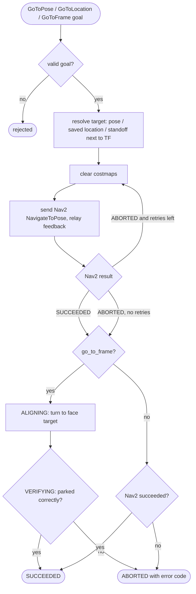
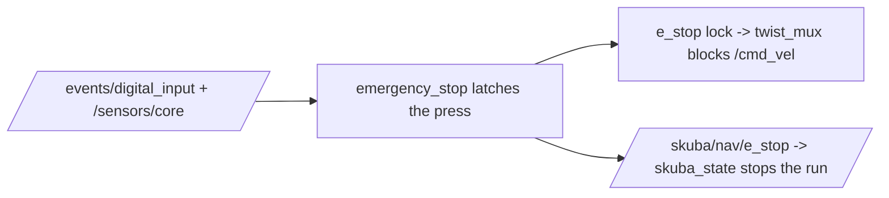

# skuba-navigation

Nav2-based navigation for the SKUBA robot (ROS 2 Humble).

The robot model lives in `skuba_description`; hardware bringup
(kobuki, LiDAR, teleop, robot_state_publisher) lives in
`skuba_bringup`. Both nav launch files include the bringup launch,
so you do not start them separately.

## Launch files

There are two task launch files. Pick one — never run both.

### 1. `cheesecake_nav.launch.py` — AMCL localization

The normal stack: hardware, nav2 with AMCL, RViz, and the service nodes.

```bash
ros2 launch skuba_navigation cheesecake_nav.launch.py
ros2 launch skuba_navigation cheesecake_nav.launch.py map:=/path/to/map.yaml
```

| Argument | Default |
| --- | --- |
| `map` | `maps/30_skuba_home/skuba_home.yaml` |
| `params_file` | `params/rcj_param.yaml` |

`launch_bringup:=false` (also on `cheesecake_slam.launch.py`) skips
`skuba_bringup` for when the robot -- or Gazebo -- is already up in its own
container (`skuba_robot`); `cheesecake_slam.launch.py use_rviz:=false` for a
container with no display.

All three launches open RViz with this repo's `rviz/cheesecake_nav.rviz`
(nav2's default view, with QoS matched to each topic). Its LaserScan display is
off by default: with it on, RViz deadlocked inside tf2 within a second of a
2D Pose Estimate. Tick it on when you need the scan.

### 2. `cheesecake_restaurant.launch.py` — white map, no AMCL

For the restaurant task, as `skuba_cheesecake_navigation` ran it. The restaurant
map is plain white (free floor, no walls), so AMCL has nothing to match. This
launch runs `cheesecake_nav.launch.py` with `use_localization:=False` (no AMCL),
plus `map_server` and a fixed `map -> odom` transform: the robot trusts its
odometry, and the `map` frame is there from the start with no initial pose.
All of `cheesecake_nav.launch.py`'s arguments work here.

```bash
ros2 launch skuba_navigation cheesecake_restaurant.launch.py
ros2 launch skuba_navigation cheesecake_restaurant.launch.py launch_bringup:=false  # skuba_robot
```

| Argument | Default |
| --- | --- |
| `map` | `maps/20_restaurant/resturant_map_long.yaml` |
| `params_file` | `params/nav2_params.yaml` |

### Building a new map (SLAM Toolbox)

`nav2_slam_bringup_launch.py` is the mapping entry point. Nothing includes it —
you run it by hand, drive the robot around, then save.

```bash
ros2 launch skuba_navigation nav2_slam_bringup_launch.py
ros2 run skuba_navigation map_save_cli        # interactive save helper
```

It runs `slam_toolbox`'s own `online_async_launch.py` (with
`params/slam_params.yaml` as `slam_params_file` — `mode: mapping`,
loop closure on, consuming `/scan`), nav2's `navigation_launch.py` (with
`params/nav2_params.yaml` as `params_file`), and RViz. It also brings up `filter_lidar`,
`emergency_stop`, and `twist_mux` directly (unlike the two task launches,
which get these via `nav2_bringup_launch.py`), so teleop driving during a
mapping session reaches the robot through the same `cmd_vel` arbitration and
software e-stop as the task launches use.

`map_save_cli` prompts for a map name, an optional category folder (e.g.
`30_skuba_home` — pick an existing one to add to it, or a new `NN_name` to
start one), and the maps root (default `maps/`), then writes directly into
`maps/<category>/<name>.{pgm,yaml,data,posegraph}` — matching the existing
layout, not a further per-map subfolder. `setup.py` installs the whole `maps/`
tree, so a new category folder is picked up on the next `colcon build` with
no edits.

### Internal launch files

Not meant to be run directly, but they are valid standalone launches:

- `nav2_bringup_launch.py` — nav2 core (localization + navigation), plus
  `emergency_stop`, `filter_lidar`, `cloud_self_filter`, `twist_mux`, and the measured `base_link -> laser`
  static transform (`publish_laser_tf`, default `true` until skuba_description's
  `laser_joint` is corrected). Included by both task launches. `use_localization:=False`
  skips AMCL (used by `nav2_slam_bringup_launch.py`'s mapping stack, which
  runs SLAM Toolbox instead of AMCL for `map -> odom`, and brings up
  `filter_lidar`/`emergency_stop`/`twist_mux` itself instead of going through
  this file).

## Nodes

Executables registered in `setup.py`:

| Executable | Purpose |
| --- | --- |
| `navigation_server` | All base-motion actions + location/costmap services (see below) |
| `save_location` | Writes the current pose into the running map's `<map>.poses.yaml` |
| `door_detector` | Reports whether the door ahead is open (`/skuba/nav/door_status`, `std_msgs/Bool`, only while switched on) |
| `costmap_reconfig_server` | Changes costmap values on the running Nav2 (`inflation_radius` no smaller than the costmap's footprint radius); `reset_costmap_config` puts the replaced values back |
| `following_server` | Runs `behavior_trees/follow_point.xml` to follow a tracked person (see "Following a person" below) |
| `cloud_self_filter` | Republishes the head camera's cloud without the robot itself (points inside the published footprint + `margin_m`) on `/skuba/nav/filtered_points`, for the costmaps' depth layers (`params/follower_param.yaml`) |
| `emergency_stop` | Publishes the twist_mux e-stop lock (`e_stop`), and the same latched state on `/skuba/nav/e_stop` for skuba-state |
| `filter_lidar` | Republishes `/scan` as `/scan_filtered` with an optional angular mask |
| `map_save_cli` | Interactive prompt to serialize the SLAM Toolbox map to disk |
| `map_editor` | Web map editor (`ros2 run skuba_navigation map_editor`, then http://<robot>:8090): paint free/wall/unknown, clean specks/holes, place named locations into the selected map's `<map>.poses.yaml` |

`cmd_vel` arbitration is handled by `twist_mux` (`params/twist_mux.yaml`): joy,
keyboard, follow and nav sources are muxed into the single `/cmd_vel` the base
drives, with `emergency_stop` holding the lock topic.

## navigation_server

Every way of moving the base is an **action** under `/skuba/nav/`, so a caller
(skuba_state's py_trees_ros behaviour trees) gets feedback, can cancel its own goal, and
learns why a goal failed. Only instant operations remain services.
**Full reference: [docs/navigation_server.md](docs/navigation_server.md)**
(goal / result / feedback fields, error codes, cancel, parameters, code
layout, migration from `nav_to_pose`).

| Action | Type | Backend | Replaces (`nav_to_pose` service) |
| --- | --- | --- | --- |
| `go_to_pose` | `GoToPose` | Nav2 | `nav_to_position` |
| `go_to_location` | `GoToLocation` | Nav2, saved location | `nav_to_name` |
| `go_to_frame` | `GoToFrame` | Nav2 + heading correction, standoff next to a TF | `nav_to_tf` |
| `rotate` | `RotateInPlace` | PD controller on `cmd_vel_nav_manual` | `rotate` |
| `drive_straight` | `DriveStraight` | closed loop on `cmd_vel_nav_manual` | `move_forward` |
| `nudge_to_frame` | `NudgeToFrame` | turn / drive / face on `cmd_vel_nav_manual` | `nudge_to_tf` |

| Service | Type | Replaces |
| --- | --- | --- |
| `clear_costmaps` | `std_srvs/Trigger` | `clear_costmap` |
| `save_location` | `SaveLocationCommand` | `save_pose` |
| `reload_locations` | `std_srvs/Trigger` | `reload_yaml` |

`cancel_goal` is gone: cancel through the action itself (the caller's goal
handle, or `ros2 service call /skuba/nav/<action>/_action/cancel_goal
action_msgs/srv/CancelGoal "{}"` to cancel all goals on that action).
A new goal on any of the six actions preempts the running one.

```bash
ros2 action send_goal --feedback /skuba/nav/go_to_location skuba_interfaces/action/GoToLocation "{location: kitchen}"
```

## Services of the other nodes

All under `/skuba/nav/`.

| Service | Node |
| --- | --- |
| `save_location_with_side` (`SaveLocationWithSide`) | `save_location` |
| `door_detector/toggle` | `door_detector` |
| `costmap_reconfig`, `reset_costmap_config`, `controller_reconfig` | `costmap_reconfig_server` |
| `enable_backward_mode`, `disable_backward_mode` | `costmap_reconfig_server` |
| `toggle_following` (`std_srvs/SetBool`) | `following_server` |
| `filter_lidar` | `filter_lidar` |

### Following a person (Carry My Luggage)

`following_server` sends one `NavigateToPose` with `follow_point.xml`; its
GoalUpdater keeps the goal on `/skuba/nav/person_pose` (`goal_updater_topic`
under `bt_navigator`, in every params file), which skuba_vision's
`person_pose_node` publishes (YOLO person + depth -> map). `TruncatePath`
stops 0.5 m short of the person. If `FollowPath` fails (e.g. RPP "collision
ahead" on a door frame while the hand carries a bag), the tree clears the local
costmap, backs up 15 cm and goes on instead of ending the goal.

| param | default | |
| --- | --- | --- |
| `keep_last_pose` | `false` | `true`: a pose older than 5 s still (re)seeds the goal -- the robot goes to where the person was last seen instead of waiting for them to reappear |

**`params/follower_param.yaml`** is the params file for this task (pass it as
`params_file`): `nav2_params.yaml` plus what following through doors with a bag,
and bringing it back past small things on the floor (TEAM1-008), needed in sim:

* local STVL from `/skuba/nav/filtered_points` (`cloud_self_filter`: the head
  camera without the arm and the bag it carries) out to 2.5 m -- the floor is
  first in view ~1.2 m out; out of view it decays in 2 s;
* a global `depth_layer` (4-45 cm, kept until a ray sees past): the lidar
  passes over a shoe or a toy. Off by default -- a followed person's legs and
  the chairs round them would ring the goal -- the task sets
  `/global_costmap/global_costmap depth_layer.enabled` to `true` for the way back;
* global inflation 1.5 / 0.60 m (plans in the middle of 0.65 m doors) and RPP
  lookahead 0.45 m (a long carrot cuts the door corner).

Two different follow switches exist: `/skuba/nav/toggle_following` (this
package's `following_server`, Nav2 follows `/skuba/nav/person_pose`) and
`/skuba/vision/toggle_following` (skuba_vision `follower_node`, drives the
twist_mux follow lane directly, no obstacle avoidance).
[CONFIRM: which one the Carry My Luggage task uses now.]

## Interfaces at a glance

Taken from the node sources on `humble` (`skuba_navigation/nodes/`, `adapters/`). Types are `skuba_interfaces` unless marked otherwise.

**Provides**: the actions and services listed in the two sections above. The topics are:

| Topic | Type | Node |
|---|---|---|
| `/skuba/nav/e_stop` | `std_msgs/Bool` (latched) | `emergency_stop`: the button state at start, then `True` once pressed |
| `e_stop` | `std_msgs/Bool` | `emergency_stop`: the twist_mux lock |
| `/skuba/nav/door_status` | `std_msgs/Bool` | `door_detector`, only while it is switched on |
| `/scan_filtered` | `sensor_msgs/LaserScan` | `filter_lidar` |
| `/skuba/nav/filtered_points` | `sensor_msgs/PointCloud2` | `cloud_self_filter` |
| `/cmd_vel` | `geometry_msgs/Twist` | `twist_mux` (joy, keyboard, follow, nav and `cmd_vel_nav_manual` in; e-stop lock) |

**Consumes**

| Endpoint | Used by | What for |
|---|---|---|
| `/navigate_to_pose` (nav2 action), `/compute_path_to_pose` | `navigation_server`, `following_server` | every Nav2-backed goal |
| `local_costmap/clear_entirely_local_costmap`, `global_costmap/clear_entirely_global_costmap` | `navigation_server` | clearing costmaps before a goal and on retry |
| `/events/digital_input`, `/sensors/core` (kobuki_ros_interfaces) | `emergency_stop` | the e-stop button |
| `/scan`, `/odom`, TF `map → odom → base_footprint` | Nav2, `navigation_server` | localisation and pose checks |
| `/camera/camera/depth/color/points` | `cloud_self_filter` | depth layers (STVL) |
| `/skuba/nav/person_pose` | `following_server` (GoalUpdater) | published by skuba_vision `person_pose_node` |
| `/local_costmap/...`, `/global_costmap/.../set_parameters` | `costmap_reconfig_server` | changing costmap values live |

## How it works

### One Nav2 goal (`go_to_pose`, `go_to_location`, `go_to_frame`)

All six actions share one goal arbiter, so a new goal on any of them preempts the one that is running. The Nav2-backed actions go through one pipeline (`core/navigation/navigation_job.py`):

1. **Validate at goal time.** Reject an empty or unknown location, an unknown side, NaN values or a zero quaternion.
2. **Resolve the target.**
   - `go_to_location` looks the name up in the running map's `<map>.poses.yaml`.
   - `go_to_frame` computes a standoff pose next to the TF frame (`stop_distance`, `approach_side`).
3. **Clear the costmaps** and, optionally, check that a path exists.
4. **Send `NavigateToPose`** and relay feedback as `NavigationProgress` (at most 5 Hz; phase changes always go out).
5. **On ABORTED**, clear the costmaps and retry, up to `navigation.max_retries` and within `timeout`.
6. **`go_to_frame` only.**
   - `ALIGNING`: turn in place to face the target.
   - `VERIFYING`: check the final pose. This check decides the outcome: if Nav2 gave up but the robot is parked correctly, the goal succeeds.
7. **Cancel, preempt or deadline** stops the base at once and is never retried.



### cmd_vel actions (`rotate`, `drive_straight`, `nudge_to_frame`)

These are closed loops on `cmd_vel_nav_manual`, through twist_mux.
- `rotate` uses a PD controller on yaw.
- `drive_straight` drives a distance at `drive_speed`.
- `nudge_to_frame` runs `ALIGNING` (turn toward the frame) → `DRIVING` (straight, to `stop_distance`) → `FACING`.

### E-stop



A press is kept until `emergency_stop` restarts.

## Docker

Compose lives in `docker/`, not the package root:

```bash
cd docker
docker compose up -d
docker exec -it skuba-nav bash
```

Runs `registry.gitlab.com/robotcitizens/skuba/robocup-opl/skuba-ahr/software-team/skuba_navigation:latest` (built from `docker/dockerfile`, based on
`osrf/ros:humble-desktop-full`) with `--network host`, `ROS_DOMAIN_ID=67`,
`privileged`, and USB passthrough for the LiDAR and kobuki base.

Host source folders are bind-mounted with paths relative to the compose file, so
the workspace can live anywhere. `build/` and `install/` are named volumes
(`nav_ws_build`, `nav_ws_install`) that persist across restarts — use
`docker compose down -v` to force a clean rebuild.

The container does **not** build on startup. `entrypoint.sh` only sources
`/opt/ros/humble/setup.bash` and, if present, `install/setup.bash`, then idles.
Build it yourself once you are inside:

```bash
cd /ros_ws
colcon build --packages-select skuba_navigation
source install/setup.bash
```

## Foxglove

The container can start a Foxglove Bridge watcher (`docker/entrypoint.sh`). It is
off by default (it costs CPU on the robot): `FOXGLOVE=1 docker compose up -d`.
Every SKUBA container has one, and they share one port, so the robot has a single
monitoring URL, `ws://<robot-ip>:8765`, whichever subsystems are up. Use it
instead of RViz on the headless robot (`use_rviz:=false`).

The Foxglove layout for the whole task, navigation included, lives in
skuba_state: `docker/foxglove/skuba_task.json`. `FOXGLOVE=0` (the default) keeps
it off.

## Build (native)

```bash
cd ~/skuba_ws
colcon build --packages-select skuba_navigation
source install/setup.bash
```

Note that `maps/` and `params/` are installed into `share/`, so a `colcon build`
is required after adding a map or editing a params file — editing the source
tree alone has no effect at runtime.

## TF tree

`odom -> base_footprint` comes from the base driver; everything below it comes
from the `skuba_description` URDF. `map -> odom` comes from AMCL in
`cheesecake_nav.launch.py`, from a fixed transform in
`cheesecake_restaurant.launch.py` (no AMCL), or from SLAM Toolbox while mapping.

```
map -> odom -> base_footprint -> base_link -> laser
                                           -> arm_base_link -> link-0 ... link-4 -> gripper
```

## Troubleshooting

RPLidar permission errors:

```bash
source ~/skuba_ws/src/rplidar_ros/scripts/create_udev_rules.sh
```

## Maintainers

- lukchin
- NapatzZ
